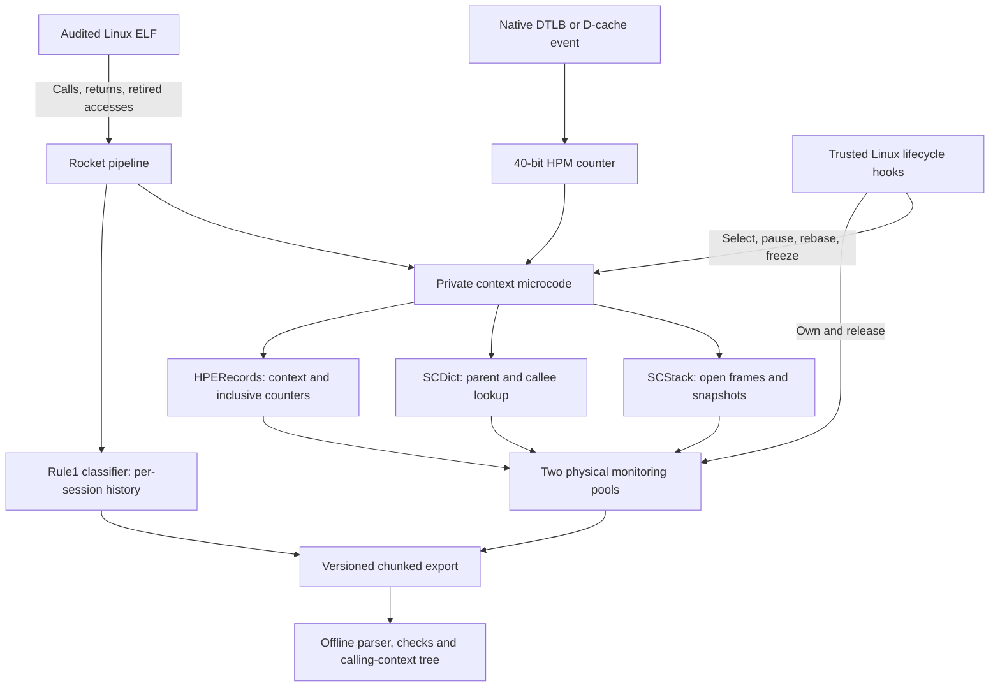

# SSA-HPM

**Software-Semantic-Aware Hardware Performance Monitoring** associates hardware
measurements with hierarchical software calling contexts on a RISC-V Rocket core.
It combines hardware-assisted call tracking, Linux session management and
versioned offline results in a reproducible single-hart research implementation.

[Project report (PDF)](report/SSA-HPM-report.pdf) ·
[Editable report and Overleaf package](report/README.md) ·
[Validation](docs/VALIDATION.md) · [Performance](docs/PERFORMANCE.md) ·
[Reproduction](REPRODUCE.md)

## What the system implements

- **Hierarchical calling contexts.** Rocket recognizes supported `JAL`/`JALR`
  calls and returns. Private microcode maintains a calling-context stack,
  dictionary and records. The same callee under different parents has distinct
  records; repeated calls on the same path accumulate in the existing record.
- **Context-associated accounting.** Every completed activation contributes
  `cycle`, `instret` and CLINT-derived `time` deltas. Parent records include child
  calls and monitoring work inside their sampling intervals.
- **Native event profiles.** ABI2 adds one 40-bit modular HPM counter. The DTLB
  profile counts **accepted page-table-walker requests**, while the Cache profile
  counts **completed outbound D-cache TileLink-A request messages**. Both use
  Rocket's real event sources and interval attribution.
- **Retired memory-access classification.** Rule1 classifies supported integer
  loads/stores using virtual address histories keyed by session, context,
  instruction PC, operation and width. Outputs are warmup, scalar-repeat,
  fixed-stride stream and irregular/unrecognized, with exclusive context counts.
- **Linux lifecycle integration.** The kernel owns each task's pool and session,
  preserves open frames through scheduling, corrects counter snapshots after
  pauses, separates successful exec images, preserves pre-commit failed exec,
  and exports results on stop or exit.
- **Controlled automatic launch.** A trusted launcher selects an audited target
  before exec. Ordinary static and tested musl dynamic executables run without
  SSA start/stop/export calls in their source or binary.
- **Complete result export.** Frozen sessions are copied in bounded chunks and
  reconstructed offline into JSON trees. Session identity, counter metadata,
  checksums, abandoned frames and classification coverage are explicit.

## Architecture



The dictionary key is `(parent record ID, callee virtual address)`. Record 0 is
reserved, records are allocated monotonically, and collision chains preserve
separate contexts. The implementation uses kernel-managed physical pools rather
than application-managed virtual stack mappings. [Calling contexts](docs/CALLING_CONTEXTS.md)
and [Linux ABI](integration/ssa/linux/ABI.md) describe the structures and interfaces.

## Event and counting semantics

| Measurement | Hardware definition | Width / selection | Attribution |
|---|---|---|---|
| `cycle` | Rocket cycle counter |64 bits| Inclusive activation interval |
| `instret` | Retired instructions, including injected monitoring instructions |64 bits| Inclusive activation interval |
| `time` | CLINT time; OpenSBI supplies architectural time reads in Linux |64 bits| Inclusive activation interval |
| DTLB profile | `DCache.io.cpu.perf.tlbMiss = io.ptw.req.fire()`; accepted PTW requests |40 bits, selector `0x1002`| Event increments inside sampled intervals |
| Cache profile | `DCache.io.cpu.perf.acquire = edge.done(tl_out_a)`; last accepted A beat completes one outbound request message |40 bits, selector `0x202`| Event increments inside sampled intervals |
| Rule1 | Valid retired integer load/store virtual addresses |64-bit category counts| Exclusive to the current context |

A firmware image fixes the ABI2 event profile. Cache traffic can include PTW and
uncached requests through the D-cache port. Request completion latency may cross
a call/return boundary, so the receiving interval determines ownership. At a
Linux switch, each open counter snapshot is increased by its actual `R − S`
pause delta, modulo the counter width. Work before `S` and after `R`, including
cache pollution effects observed after resume, stays in that task's interval.
See [event attribution](docs/CACHE_EVENT_ATTRIBUTION.md) and
[classification rules](docs/CLASSIFICATION.md).

## Validation results

The accepted implementation is preserved by [`v0.2.0`](https://github.com/Kimberley-Inti/ssa_hpm/releases/tag/v0.2.0).
Public-baseline reconstruction generated RTL and built a new Verilator model.
Three separately built Linux payloads used matching kernel/firmware source trees.

| Validation | Actual result |
|---|---|
| Directed reference and RTL matrix |6 Spike reference tests and 34 Rocket RTL tests passed |
| Retirement observation oracle |9 checks;82 candidates,72 accepted accesses,7 replays and 1 exception |
| Calling-context fixture |6 records; `common.instret` 14452 and 7226 on distinct parent paths |
| Production Rocket/Linux |51 automatic-launch and 26 manual-interface checks;17 sessions/215 records; native exit 0 and normal shutdown |
| Production postchecks |10 ELF-capacity,5 automatic semantic-negative and 3 classification-negative checks |
| Independent performance work |150 bare-metal and 150 Linux samples; all 300 results match closed-form arithmetic |
| Linux accounting companion |2 real tasks,4 records,8 snapshot-account rows;20 checks and 5 host mutation cases passed |
| Evidence replay |12 host-only replay steps passed; raw receipts distinguish native execution from replay |

The matrix covers nested/repeated calls, different parent paths, return recovery,
collision chains, capacity guards, register transparency, traps, timer-driven
preemption, exec, exit, complete chunked export and observable classification
capacity loss. Spike supplies applicable reference behavior; Rocket RTL supplies
the SSA implementation evidence. Linux DTLB evidence and untested automatic
combinations retain their recorded coverage. [Validation details](docs/VALIDATION.md)
link every result to its commands, hashes and original logs.

## Performance evaluation

Measurements use independent target-side cycle/instruction/time boundaries on
the same extended hardware model, one warmup and five measured repetitions.

| Bare-metal workload | Monitoring off, median cycles | Basic monitoring | Runtime ratio | Increase |
|---|---:|---:|---:|---:|
|128 leaf calls|1088|46328|42.58×|4158.1%|
|Depth 16 recursion|282|6620|23.48×|2247.5%|
|32 KiB stream|52224|52641|1.0080×|0.80%|
|32 KiB irregular permutation|103375|103784|1.0040×|0.40%|

Serialized call/return microcode and dictionary/frame accesses dominate the
call-heavy result. Linux samples also expose emulated `rdtime` cost and periodic
interrupt variation. The [performance report](docs/PERFORMANCE.md) preserves
absolute values, ranges, initialization/switch/exec/export boundaries and the
instruction accounting. Hardware area, power and physical-frequency evaluation
remain future measurements.

## Supported configuration

The validated domain is one hart, trusted kernel/firmware and audited
non-privileged single-thread LIFO ELF programs, including the tested musl
interpreter/DSO path. Calls use supported `x1`/`x5` conventions. Two 36 MiB physical
pools support two monitored sessions; diagnostics retain at most 12 pauses per
session. Full-tree inputs stay within 256 frames. Classification has two banks,
63 usable rows and 16 FIFO histories per bank, for retired integer 1/2/4/8-byte
loads/stores. Warmup, eviction, dropped coverage and abandoned calls are visible.
The tested musl continuation has an explicitly abandoned loader frame.

Migration, shared-mm/vfork, arbitrary non-local control flow and automatic DTLB
combinations are outside this validated configuration. The [acceptance matrix](docs/ACCEPTANCE.md)
and [completion checklist](docs/FINAL_CHECKLIST.md) give the exact boundaries.

## Reproduce or inspect

Fast evidence verification runs Python parsers and oracles against the committed
captures, without starting a simulator. Choose a new output directory:

```sh
python3 scripts/final.py check-evidence --out /tmp/ssa-evidence-check
```

The full entry fetches public pinned baselines, applies project patches, builds
RTL and Linux payloads, and executes the validation matrix. It accepts an
existing matching Chipyard dependency cache:

```sh
python3 scripts/final.py reproduce /tmp/ssa-rebuild   --reuse-dependencies /path/to/chipyard-cache --jobs 6
```

A verified musl cache can be supplied with `--musl-cache`; otherwise the builder
fetches its pinned source. [REPRODUCE.md](REPRODUCE.md) records prerequisites,
versions and individual commands. Full Linux simulation takes hours on the
recorded VM; existing successful receipts can be replayed directly.

## Documentation and report

[Documentation index](docs/README.md) groups material by implementation topic.
The [English report](report/SSA-HPM-report.pdf) uses the supplied ACL LaTeX layout;
[editable source and the Overleaf ZIP](report/README.md) include figures and references.
[Development history](HISTORY.md) and the [reference map](docs/HISTORY_MAP.json)
preserve original commits, former branch/document names and immutable evidence
locations. [`v0.2.0`](https://github.com/Kimberley-Inti/ssa_hpm/releases/tag/v0.2.0)
keeps the accepted implementation; subsequent presentation commits organize the
same implementation for public reading.

## Sources and licensing

The repository distributes project patches, fixtures, analysis tools, reports
and compact textual evidence. Upstream source trees are fetched during rebuild.
[Source and license notices](THIRD_PARTY.md) identify Rocket Chip, Chipyard,
Linux, OpenSBI, musl and the report template. Explicit SPDX licenses apply to
marked files; other original materials retain their authors' rights.
